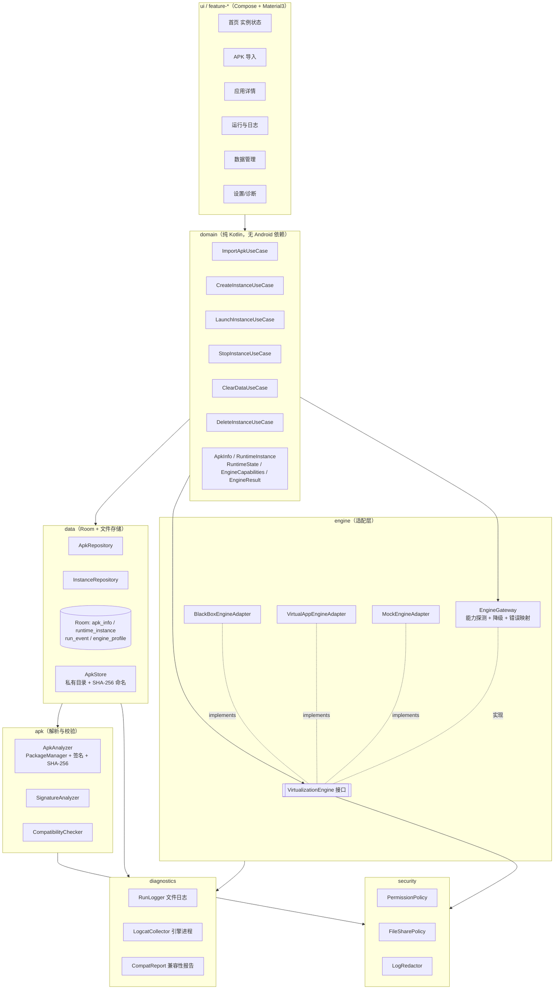
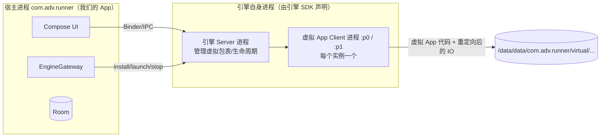
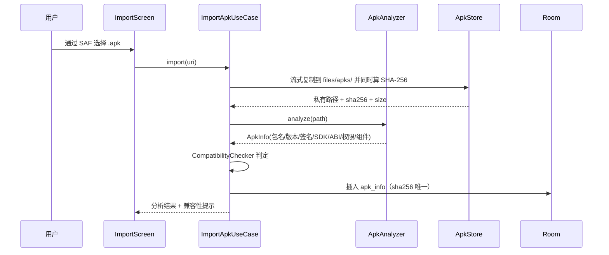
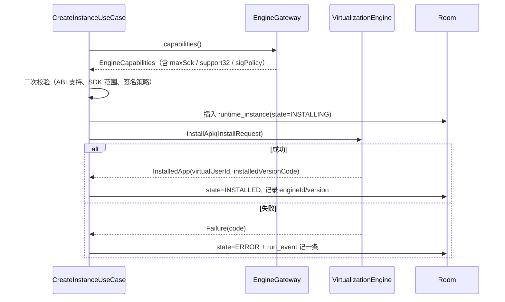

# 系统架构设计

## 1. 分层与依赖方向



**依赖规则（硬约束）**

1. `domain` 只依赖接口（`VirtualizationEngine`、Repository 接口），**不 import 任何引擎 SDK**。
2. `engine:*` 实现类**只能**被 `engine:gateway` 通过工厂实例化；UI 永远拿不到引擎对象。
3. `apk` 模块纯解析，不写数据库、不碰引擎。
4. `security` 只输出**策略与判定结果**，不直接执行"假隔离"。凡是底层引擎做不到的，判定结果必须是 `UNSUPPORTED`。
5. 所有跨层传递的失败都用 `EngineResult.Failure(code, message)`，禁止吞异常。

---

## 2. 运行期结构（为什么这个 App 会有多个进程）



要点：

- 虚拟 App **不是**独立系统 App，它跑在宿主 UID 下的子进程里；因此宿主必须有 `INTERNET` 等权限，虚拟 App 才能联网。
- 引擎重启/被系统杀死后，我们的 UI 必须靠"状态对账"发现，而不是缓存里的 `RUNNING`。
- 厂商 ROM 的省电策略会杀子进程 → 必须在设置页给"后台保活/电池优化"引导，并诚实说明可能失败。

---

## 3. 模块目录结构

```text
adv/
├── settings.gradle.kts
├── build.gradle.kts
├── gradle/libs.versions.toml
├── app/                                  # 壳 App：Compose + 导航 + DI 装配
│   └── src/main/java/com/adv/runner/
│       ├── AdvApp.kt
│       ├── MainActivity.kt
│       └── di/AppModule.kt
├── core/
│   ├── model/                            # 纯 Kotlin 数据模型（无 Android 依赖）
│   │   └── src/main/kotlin/com/adv/core/model/
│   │       ├── ApkInfo.kt
│   │       ├── RuntimeInstance.kt
│   │       ├── RuntimeState.kt
│   │       ├── EngineCapabilities.kt
│   │       └── EngineResult.kt
│   └── common/                           # 时间/哈希/格式化/Result 扩展
├── domain/
│   └── src/main/kotlin/com/adv/domain/
│       ├── repository/                   # 接口
│       └── usecase/                      # Import/Create/Launch/Stop/Clear/Delete
├── data/
│   ├── db/                               # Room：entity/dao/database/migration
│   └── apkstore/                         # APK 私有目录、导入复制、SHA-256
├── apk/                                  # APK 解析与签名分析
│   └── src/main/kotlin/com/adv/apk/
│       ├── ApkAnalyzer.kt
│       ├── SignatureAnalyzer.kt
│       ├── CompatibilityChecker.kt
│       └── SplitApkInspector.kt
├── engine/
│   ├── api/                              # VirtualizationEngine 接口 + 上下文 + 错误码
│   ├── gateway/                          # 选引擎、能力探测、降级、错误映射、状态对账
│   ├── blackbox/                         # BlackBox(2.1.0 tag) 适配实现
│   ├── virtualapp/                       # VirtualApp 商业版适配实现（付费后启用）
│   └── mock/                             # 假引擎：只跑流程，UI 开发期用
├── security/
│   └── src/main/kotlin/com/adv/security/
│       ├── PermissionPolicy.kt
│       ├── FileSharePolicy.kt
│       └── LogRedactor.kt
├── diagnostics/
│   └── src/main/kotlin/com/adv/diagnostics/
│       ├── RunLogger.kt
│       ├── LogcatCollector.kt
│       └── CompatReport.kt
├── feature/
│   ├── home/  import/  detail/  run/  data/  settings/
└── docs/
```

> 当前交付的骨架把上述包**平铺在 `app` 单模块内**（同样的包名 `com.adv.runner.*`），先用单模块把引擎跑通，阶段 3 再按上表拆分。**不做"先拆 12 个模块再发现引擎不可用"的无用功。**

---

## 4. 关键数据流

### 4.1 导入 APK



**约束**

- 复制到私有目录后才解析：避免 SAF uri 失效、避免"边读边被替换"的 TOCTOU。
- 同 `sha256` 已存在 → 复用记录，不重复占空间。
- `versionCode` 相同但 `sha256` 不同 → 标记"同版本不同内容"，需用户确认。
- 解析失败（加固壳导致 `PackageManager` 读不出、split APK 无 base）→ 明确报错，不创建实例。

### 4.2 创建实例与安装



**签名策略（这条决定"能不能覆盖"）**

| 情况 | 判定 | 行为 |
|---|---|---|
| 实例不存在 | `FIRST_INSTALL` | 直接创建 |
| 已存在实例，签名摘要集合相同，versionCode 升高 | `SAME_SIGNATURE_UPDATE` | 允许升级，保留数据 |
| 已存在实例，签名不同 | `SIGNATURE_MISMATCH` | **禁止自动覆盖**。UI 必须弹二次确认，并明确"清除数据后重装"或"新建第二个实例" |
| 宿主机已安装同包名（系统 PMS 里） | 仅记录，**不触碰** | 我们从不 `uninstall`/`install` 宿主机包；只读 `PackageManager` 拿信息 |

> 注意：`SIGNATURE_MISMATCH` 时"新建第二个实例"是引擎决定的能力。BlackBox/VA 的 userId 机制理论上支持（同包名多 userId），但**是否支持同包名不同签名并存，必须由阶段 2 实测结论决定**；不支持时 UI 必须直接禁用该入口，而不是给一个必失败的按钮。

### 4.3 启动 / 停止 / 状态对账

- `launch` 返回不代表"已在前台"：引擎的 `launch` 是"发起启动"。真实状态靠三处证据合成：
  1. 引擎 `isRunning(instanceId)`（若提供）；
  2. `ActivityManager.getRunningAppProcesses()` 里引擎 client 进程存活（需权限，Android 5.1+ 只返回自己的进程，**可行**）；
  3. 已知的 client 进程 PID 是否存活（`/proc/<pid>`，读不到则降级）。
- App 回到前台、设备重启、引擎崩溃 → 触发 `reconcile()`：把数据库中"非终态"的实例与真实状态对齐，写 `run_event(kind=STATE_RECONCILED)`。

---

## 5. 存储布局（数据隔离的物理保证）

```text
/data/data/com.adv.runner/
├── files/
│   ├── apks/
│   │   └── <sha256>.apk                     # 原始 APK 副本（未修改，只读校验）
│   ├── engine/<engineId>/
│   │   ├── packages/                        # 引擎解析出的包表/odex
│   │   └── vuser/<virtualUserId>/<pkg>/     # 每个实例的私有数据根
│   ├── logs/
│   │   ├── run-2026-10-23.log               # 已脱敏的运行日志
│   │   └── crash-<ts>.txt                   # 崩溃/ANR 快照
│   └── backup/<instanceId>/<ts>/            # 手动导出的实例数据（zip）
└── cache/
    └── engine/                              # 可随时清理
```

**隔离规则（代码级强制）**

1. 宿主 App 的 `SharedPreferences`/Room **绝不**出现在虚拟 App 可见路径；虚拟 App 的数据根在 `files/engine/...`，与宿主业务数据不同目录树。
2. 不向虚拟 App 共享宿主机原 App 的 `/data/data/<目标包名>`（本来也读不到，非 Root 无权限）。
3. `FileSharePolicy` 默认策略：**不把宿主的 `files/`、`cache/` 挂给虚拟 App**；只允许"用户在数据管理页显式导出"这一条单向通道。
4. 删除实例 = 删除 `vuser/<virtualUserId>/` + 引擎包表记录 + 数据库行；**绝不**遍历删除 `files/` 根目录（防误删 APK 库）。

---

## 6. 线程与并发

| 场景 | 方案 |
|---|---|
| APK 解析/哈希 | `Dispatchers.IO`，流式 8KB buffer，逐个上报进度（`StateFlow<Float>`） |
| 引擎调用 | `Dispatchers.Default` + `Mutex` 串行化（引擎 SDK 大多非线程安全，且包表操作必须串行） |
| UI 状态 | `StateFlow<UiState>` + `repeatOnLifecycle` |
| 长任务（安装/删除） | `WorkManager`（可选）+ 前台通知，避免进程被杀导致"安装中"永久卡住 |
| 日志写入 | 单写线程 + `Channel`，不阻塞主流程 |

---

## 7. 失败与降级模型

```kotlin
sealed interface EngineResult<out T> {
    data class Success<T>(val value: T) : EngineResult<T>
    data class Failure(
        val code: EngineErrorCode,
        val message: String,
        val cause: Throwable? = null,
        val diagnosticsId: String? = null   // 指向 run_event 一行 + 日志片段
    ) : EngineResult<Nothing>
}
```

| 错误码 | 含义 | UI 表现 |
|---|---|---|
| `ENGINE_NOT_AVAILABLE` | 引擎未初始化/so 加载失败 | "运行引擎不可用"，引导查看诊断 |
| `UNSUPPORTED_BY_ENGINE` | 引擎明确不支持该能力 | 灰掉功能 + 说明原因（**不许假装成功**） |
| `ABI_MISMATCH` | 目标 APK 的 so 与设备/引擎 ABI 不符 | 明确"32 位应用在当前设备的沙箱内无法运行" |
| `SDK_OUT_OF_RANGE` | 引擎支持的 Android 版本不覆盖当前系统 | 明确机型不支持 |
| `SIGNATURE_MISMATCH` | 与已有实例签名不同 | 弹确认，要求选"新实例"或"清数据重装" |
| `INSTALL_FAILED` / `LAUNCH_FAILED` / `CRASHED` / `ANR` | 引擎返回或进程消失 | 展示日志片段 + "重试/清除数据" |
| `INSUFFICIENT_STORAGE` | 空间不足 | 提示剩余空间与所需空间 |
| `INTERNAL` | 兜底 | 打日志 + 上报本地报告文件 |

---

## 8. 安全边界（在产品里必须显式声明的三句话）

1. 这是**用户态应用级虚拟化**，不是虚拟机、不是独立内核。虚拟 App 与宿主**同 UID**，恶意 App 理论上可以攻击宿主进程与其它实例。
2. 我们不提供"内核级数据隔离"承诺；能保证的只是**路径隔离 + 引擎的组件代理 + 不主动共享宿主数据**。
3. 权限页的开关是**策略提示 + 引擎支持范围内的拦截**；引擎不支持时，开关会标灰并写明"仅提示，底层不生效"。**不设假开关。**
