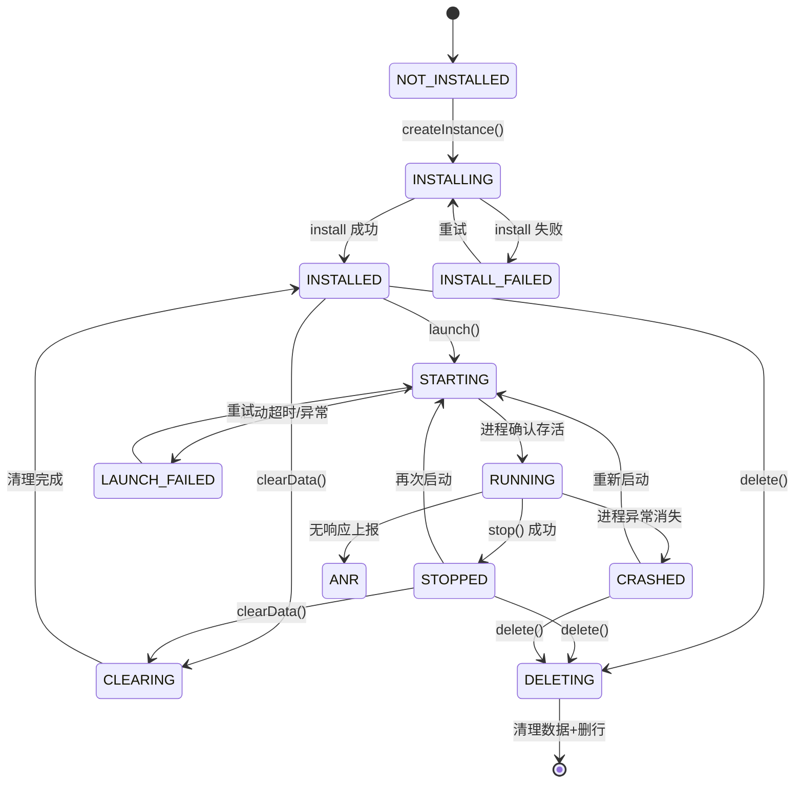

# 核心数据模型与数据库设计

## 1. 领域模型（纯 Kotlin，`core:model`）

### 1.1 APK 元数据

```kotlin
data class ApkInfo(
    val id: String,                       // uuid
    val packageName: String,
    val versionName: String,
    val versionCode: Long,
    val appLabel: String,
    val sha256: String,                   // 全文件 SHA-256（唯一键）
    val fileSize: Long,
    val storedPath: String,               // files/apks/<sha256>.apk
    val originalFileName: String?,
    val signerSha256: List<String>,       // 签名证书集合的 SHA-256（多签名/多证书）
    val signerSubject: String?,
    val signerValidFrom: Long?,
    val minSdk: Int,
    val targetSdk: Int,
    val compileSdk: Int?,
    val abis: List<String>,               // 来自 nativeCode；空 = 纯 Java
    val permissions: List<ApkPermission>,
    val launcherActivity: String?,
    val componentSummary: ComponentSummary,
    val isSplitApk: Boolean,
    val isDebuggable: Boolean,
    val importedAt: Long,
    // 分析结论（派生，落库便于列表页直接展示）
    val compat: CompatibilityVerdict
)

data class ApkPermission(
    val name: String,
    val isDangerous: Boolean,
    val protectionLevel: String,          // normal / dangerous / signature ...
    val group: String?
)

data class ComponentSummary(
    val activities: Int,
    val services: Int,
    val receivers: Int,
    val providers: Int,
    val exportedComponents: List<String>, // 便于风险提示
    val permissionUsedByExported: List<String>
)

data class CompatibilityVerdict(
    val deviceSdk: Int,
    val engineSdkRange: IntRange?,        // 引擎自述支持范围
    val abiSupported: Boolean,
    val targetSdkBlocked: Boolean,        // 见 1.2
    val issues: List<CompatIssue>
)

data class CompatIssue(
    val severity: Severity,               // INFO / WARN / BLOCKER
    val code: String,                     // 如 ABI_MISMATCH / TARGET_SDK_LOW / SIGN_BOUND_SDK
    val message: String                   // 中文，面向用户
)
```

### 1.2 `targetSdk` 判定口径（必须是事实，不是猜测）

| 条件 | 判定 | 说明 |
|---|---|---|
| `minSdk > deviceSdk` | `BLOCKER` | 系统版本低于 App 要求，装上都跑不了 |
| APK 有 `nativeCode` 且与设备 ABI 无交集 | `BLOCKER` | 典型：32 位 so 遇到纯 64 位设备 |
| APK 有 `arm64-v8a` 却没有对应引擎产物 | `BLOCKER` | 引擎分架构构建时（BlackBox 分 32/64 两个产物）必须匹配 |
| `targetSdk < 23` | `WARN` | 注意：这是**系统安装器**的拦截条件（Android 14 起不允许安装 targetSdk<23 的包）。引擎内部安装不走系统安装器，**是否同样受限属于待实测项**；即便能装，App 自身的老 API 调用可能崩 |
| `targetSdk < 设备 SDK - 4` | `WARN` | 命中行为变更概率高，提示"兼容性风险" |
| 签名/包名绑定（已知 SDK） | `INFO` | 不自动判定，只提示"若使用微信/支付宝/地图等 SDK，换签名后相关功能可能不可用" |

> 不要用"targetSdk 低就等于不能用"这种一刀切逻辑。**判定必须是可解释的、可被实测推翻的。**

### 1.3 运行实例

```kotlin
data class RuntimeInstance(
    val id: String,
    val apkId: String,
    val packageName: String,             // 冗余，便于查询
    val displayName: String,             // 默认 "包名 · 版本名"
    val engineId: String,                // "blackbox" / "virtualapp" / "mock"
    val engineVersion: String,
    val virtualUserId: Int,              // 引擎内的 userId 槽位
    val state: RuntimeState,
    val signatureMode: SignatureMode,    // FIRST_INSTALL / SAME_SIGNATURE_UPDATE / SIGNATURE_MISMATCH
    val signatureAckAt: Long?,           // 用户确认过签名变更的时间
    val installedVersionCode: Long?,
    val installedAt: Long?,
    val lastLaunchedAt: Long?,
    val lastExitReason: ExitReason?,     // USER_STOPPED / CRASHED / KILLED / ANR / UNKNOWN
    val dataRoot: String,                // files/engine/<engineId>/vuser/<uid>/<pkg>
    val createdAt: Long,
    val updatedAt: Long
)

enum class SignatureMode { FIRST_INSTALL, SAME_SIGNATURE_UPDATE, SIGNATURE_MISMATCH }

enum class ExitReason { USER_STOPPED, CRASHED, KILLED_BY_SYSTEM, ANR, UNKNOWN }
```

### 1.4 运行状态机（唯一真相：数据库 + 对账）



**不变式**

- `RUNNING` 只能由"对账逻辑拿到进程存活证据"后写入，不能由 `launch()` 直接写。
- 任何非终态（`INSTALLING`/`STARTING`/`CLEARING`/`DELETING`）若超过 90s 未推进，进程重启后一律降级为 `UNKNOWN_INTERRUPTED` 并提示用户重试。
- 删除实例是**幂等**的：重复调用不报错，只补做未完成的清理。

### 1.5 引擎能力

```kotlin
data class EngineCapabilities(
    val engineId: String,
    val engineVersion: String,
    val supportedSdk: IntRange,            // 引擎自述 + 本机实测标记
    val samePackageDifferentSignature: Capability,
    val multiInstance: Capability,
    val nativeLibs: Capability,
    val supports32BitApk: Capability,
    val webView: Capability,
    val gms: Capability,
    val notificationProxy: Capability,
    val backgroundService: Capability,
    val clearData: Capability,
    val exportData: Capability,
    val permissionInterception: Capability,
    val requiresRoot: Boolean,
    val notes: List<String>                // 已知限制的人话说明
)

enum class Capability { SUPPORTED, PARTIAL, UNSUPPORTED, UNKNOWN }

data class EngineSelfCheck(
    val passed: Boolean,
    val checks: List<SelfCheckItem>        // so 是否加载、启动耗时、包表可写、存储可用 ...
)
```

> `UNKNOWN` 是合法值且**必须**在 UI 显示为"未验证"。禁止把 `UNKNOWN` 当 `SUPPORTED` 用。

---

## 2. Room 数据库设计

数据库名 `adv.db`，版本 1。所有时间戳为 `Long`（epoch millis），所有枚举存 `TEXT`（可读、可迁移）。

### 2.1 `apk_info`

```sql
CREATE TABLE apk_info (
    id            TEXT NOT NULL PRIMARY KEY,
    package_name  TEXT NOT NULL,
    version_name  TEXT NOT NULL,
    version_code  INTEGER NOT NULL,
    app_label     TEXT NOT NULL,
    sha256        TEXT NOT NULL,
    file_size     INTEGER NOT NULL,
    stored_path   TEXT NOT NULL,
    original_name TEXT,
    signer_sha256 TEXT NOT NULL,   -- JSON 数组
    signer_subject TEXT,
    min_sdk       INTEGER NOT NULL,
    target_sdk    INTEGER NOT NULL,
    compile_sdk   INTEGER,
    abis          TEXT NOT NULL,   -- JSON 数组
    permissions   TEXT NOT NULL,   -- JSON 数组
    launcher_activity TEXT,
    components    TEXT NOT NULL,   -- JSON
    is_split      INTEGER NOT NULL DEFAULT 0,
    is_debuggable INTEGER NOT NULL DEFAULT 0,
    imported_at   INTEGER NOT NULL
);
CREATE UNIQUE INDEX idx_apk_sha256 ON apk_info(sha256);
CREATE INDEX idx_apk_pkg ON apk_info(package_name, version_code DESC);
```

> `permissions`/`components`/`abis` 用 JSON 列而不是关联表：这些数据只做展示与筛查，不需要 JOIN 查询，落成表反而增加迁移成本。

### 2.2 `runtime_instance`

```sql
CREATE TABLE runtime_instance (
    id              TEXT NOT NULL PRIMARY KEY,
    apk_id          TEXT NOT NULL,
    package_name    TEXT NOT NULL,
    display_name    TEXT NOT NULL,
    engine_id       TEXT NOT NULL,
    engine_version  TEXT NOT NULL,
    virtual_user_id INTEGER NOT NULL,
    state           TEXT NOT NULL,
    signature_mode  TEXT NOT NULL,
    signature_ack_at INTEGER,
    installed_version_code INTEGER,
    installed_at    INTEGER,
    last_launched_at INTEGER,
    last_exit_reason TEXT,
    data_root       TEXT NOT NULL,
    created_at      INTEGER NOT NULL,
    updated_at      INTEGER NOT NULL,
    FOREIGN KEY(apk_id) REFERENCES apk_info(id) ON DELETE RESTRICT
);
CREATE UNIQUE INDEX idx_instance_slot ON runtime_instance(engine_id, virtual_user_id);
CREATE INDEX idx_instance_state ON runtime_instance(state);
CREATE INDEX idx_instance_pkg ON runtime_instance(package_name);
```

`ON DELETE RESTRICT`：只要有实例引用，APK 文件就不许删。删除实例后再由清理任务回收孤儿 APK。

### 2.3 `run_event`（诊断日志索引，日志正文在文件里）

```sql
CREATE TABLE run_event (
    id          INTEGER PRIMARY KEY AUTOINCREMENT,
    instance_id TEXT,
    package_name TEXT,
    ts          INTEGER NOT NULL,
    level       TEXT NOT NULL,      -- DEBUG/INFO/WARN/ERROR
    kind        TEXT NOT NULL,      -- INSTALL/LAUNCH/STOP/CRASH/ANR/CLEAR/DELETE/RECONCILE
    code        TEXT,               -- EngineErrorCode
    message     TEXT NOT NULL,      -- 已脱敏
    log_file    TEXT,               -- 对应日志文件相对路径
    detail_ref  TEXT                -- 日志片段偏移或 trace id
);
CREATE INDEX idx_event_instance ON run_event(instance_id, ts DESC);
CREATE INDEX idx_event_ts ON run_event(ts);
```

**保留策略**：`run_event` 保留最近 2000 条或 30 天（先到为准）；日志文件单文件 2MB 滚动，最多 10 个，总计 ≤20MB。设置页提供"一键清空诊断数据"。

### 2.4 `engine_profile`（引擎探测结果缓存）

```sql
CREATE TABLE engine_profile (
    engine_id       TEXT NOT NULL PRIMARY KEY,
    engine_version  TEXT NOT NULL,
    device_sdk      INTEGER NOT NULL,
    device_abis     TEXT NOT NULL,   -- JSON
    capabilities    TEXT NOT NULL,   -- JSON(EngineCapabilities)
    last_check_at   INTEGER NOT NULL,
    last_result     TEXT NOT NULL    -- PASS / FAIL / PARTIAL
);
```

作用：换了引擎版本或系统升级（`device_sdk` 变化）→ 缓存失效，强制重新自检。避免"上次能用这次直接崩"。

### 2.5 设置（DataStore，不进 Room）

`logLevel`、`themeMode`、`defaultEngineId`、`autoReconcileOnResume`、`keepScreenOnWhileRunning`。
不把用户凭据类信息写任何地方——**本项目永不存储目标 App 的账号密码**（那是目标 App 自己的事，我们无权也无需介入）。

---

## 3. 备份与导出

- **备份**：`backup/<instanceId>/<ts>/` 下的 zip，内容 = 虚拟 App 数据根目录快照 + `manifest.json`（包名/版本/签名摘要/引擎版本/时间）。**明确不包含**账号密码类内容（我们也不解析）。
- **导入备份**：仅在"包名 + 签名摘要 + 引擎 ID"全部匹配时允许恢复；否则报 `BACKUP_INCOMPATIBLE`，不静默覆盖。
- 备份默认不含宿主原 App 任何数据（物理上也没有）。

---

## 4. 迁移与容错

| 场景 | 处理 |
|---|---|
| 数据库升级 | `Migration` 显式写出；禁止 `fallbackToDestructiveMigration`（会丢实例元数据导致数据根变孤儿） |
| 实例行存在但 `data_root` 不存在 | 状态置 `NOT_INSTALLED`，提示"数据已丢失，需重装"；不清库 |
| `data_root` 存在但无实例行（孤儿目录） | 设置页"存储清理"里列出，需用户确认后删除 |
| 引擎切换（mock → blackbox） | 实例 `engineId` 不匹配时禁止启动，提示"需在新引擎下重建实例"（不同引擎的数据根不通用） |
| 引擎版本升级导致包表不兼容 | 自检失败 → 全实例置 `ENGINE_INCOMPATIBLE`，提供"重装实例（保留 APK）"动作 |
