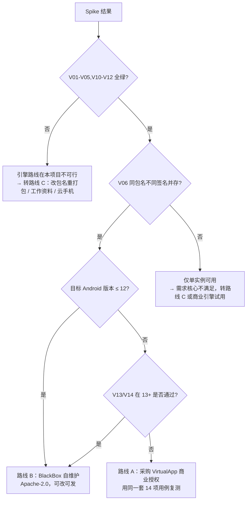

# 阶段二：最小验证原型（Spike）

> 目的：**用最小成本证明或证伪"所选引擎能在普通非 Root 手机上运行同包名、不同签名的独立实例"。**
> 时间盒：5 个工作日。**不要写 Compose UI，不要接 Room。** 只要一个能 import / install / launch / 看 logcat 的壳。
> 判定结果直接决定后续走哪条路线（见 §6）。

---

## 0. 设备现实带来的重新评估（2026-10-23 更新）

首台真机为 **realme RMX3888 / Android 16（API 36）/ 仅 arm64-v8a**（见 `device-matrix.md`）。
对该设备的引擎成本做了**源码级核查**（浅克隆 `FBlackBox/BlackBox` 的 `2.1.0` tag）：

| 核查项 | 实际值 | 影响 |
|---|---|---|
| Gradle Wrapper | `gradle-6.5-all` | 只支持到 JDK 14，本机 JDK 17 直接跑不起来 |
| AGP | `4.0.1` | 与 JDK 17 / 现代 AGP 不兼容，需整体升级到 AGP 8.x |
| Kotlin | `1.4.31` | 升到 2.x 需处理 Compose/语言版本差异（Bcore 自身不重） |
| 依赖仓库 | `jcenter()` + `jitpack.io` | jcenter 已停服，多个三方 UI 库需替换或删除 |
| compileSdk / targetSdk | 29/30 | 可安装（Android 16 只拦 targetSdk<24），但行为变更未适配 |
| 版本兼容代码 | `BuildCompat` 最高只到 `isS()`（Android 12），**无 13/14/15/16 分支** | 在 Android 16 上大概率在 `startup()` 阶段失败 |
| 是否支持"从任意 APK 路径安装" | **支持**：`BlackBoxCore.installPackageAsUser(File apk, int userId)` | V06 的前提成立，不必改为"只能克隆已装应用" |
| 原生库 | 需 NDK（本机已有 27/28.2/30）+ CMake 3.22.1 | 可构建 |

**结论：在原设备（Android 16）上把 BlackBox 2.1.0 跑起来，不是"spike"，而是"移植工程"（工具链升级 + 框架行为适配，人周级），且成功率不确定。**
因此调整顺序：

1. **先做零成本、确定性收益的两件事**（已完成）：APK 解析准确性验证、系统级签名冲突取证。
2. **需要决策**：是否为 BlackBox 移植投入 1–2 周（低成功率），或直接走 VirtualApp 商业版试用/授权（唯一有 Android 13–17 声明的路线），或退回"改包名重打包"的单 App 方案。
3. 若能借到一台 **Android 12/13** 设备，则 BlackBox 探针的性价比立刻恢复：先在旧设备证明机制成立，再把"能不能上新系统"作为独立课题。

---

## 1. 前置条件

| 项 | 要求 |
|---|---|
| 设备 | 至少 3 台：Android 13（API 33）、Android 15（API 35）、Android 16（API 36）。**必须至少有一台是用户真实使用的主力机型/ROM**（小米/华为/OPPO 等厂商 ROM 与 AOSP 的差异经常是失败主因） |
| 许可 | 设备允许"USB 调试 + 安装未知来源应用"；不需要 Root，不需要解锁 BL |
| 工具 | JDK 17、Android Studio（AGP 8.x）、`adb`、`apksigner`、`keytool`（JDK 自带）、`zipalign` |
| 代码 | `FBlackBox/BlackBox` 的 **`2.1.0` tag**（Apache-2.0，默认分支已被清空，**必须用 tag**） |
| 时间 | 5 天：D1 环境 + 探针构建，D2 单实例跑通，D3 双签名双实例，D4 目标 App 实测，D5 结论与报告 |

> 本次开发机已确认存在：JDK 17、Android SDK（platforms 34/35/36/36.1/37.0、build-tools 34–37）、`adb`。当前**没有连接真机**（`adb devices` 为空），阶段 2 必须接一台真机。

---

## 2. 测试 APK 的构造（关键：必须自己造，不能只靠现成 App）

### 2.1 Probe App 需求

一个自建 App（`com.adv.probe`），**同一份代码用两把不同的 keystore 各签一次**，得到两个 APK：

| 文件名 | 包名 | versionCode | versionName | 签名 |
|---|---|---|---|---|
| `probe-A-v1.apk` | `com.adv.probe` | 1 | 1.0 | keystoreA |
| `probe-A-v2.apk` | `com.adv.probe` | 2 | 2.0 | keystoreA（同签名升级用） |
| `probe-B-v1.apk` | `com.adv.probe` | **1** | **1.0-B** | **keystoreB（不同签名）** |

Probe App 必须包含以下"能力探针"，每项在界面上显示 ✅/❌ 并写日志：

1. **SharedPreferences** 读写 + 重启后仍在（数据持久化）
2. **SQLite**（Room 或 `SQLiteOpenHelper`）建表插入计数（数据持久化）
3. **文件 IO**：向 `filesDir` 写 `probe.txt` 并回读（IO 重定向是否正常）
4. **网络**：请求 `https://www.google.com/generate_204` 或任一可达 HTTPS 接口，显示状态码（网络是否通、TLS 是否正常）
5. **WebView**：加载 `data:text/html` 或一个本地 HTML（WebView 多实例是否可初始化）
6. **Service**：`startService` + 前台服务（Android 14 需声明 `foregroundServiceType`）——**验证后台服务**
7. **BroadcastReceiver**：动态注册（Android 14 必须带 `RECEIVER_EXPORTED/NOT_EXPORTED`）+ 静态注册各一
8. **ContentProvider**：自带一个 `FileProvider` 并 `content://` 自读一次（组件代理是否生效）
9. **通知**：发一条通知（Android 13 需运行时 `POST_NOTIFICATIONS`）
10. **JNI**：加载一个自带的 `.so`（`externalNativeBuild` 写个返回字符串的 JNI 函数），验证 native 库加载与 32/64 位
11. **双实例区分**：显示 `Process.myPid()`、`Process.myUid()`、`filesDir` 绝对路径、随机 UUID（存在 SP 里），**用来证明两个实例是两份独立数据**
12. **`targetSdk` 变体**：再造一个 `targetSdk=28` 的构建（验证老 targetSdk 在新系统 + 引擎内的表现）

### 2.2 生成签名与重签名命令

```bash
# 两把不同的 keystore
keytool -genkeypair -v -keystore probeA.jks -alias probeA -keyalg RSA -keysize 2048 \
        -validity 10000 -storepass 123456 -keypass 123456 \
        -dname "CN=Probe A, OU=Test, O=Adv, L=SH, ST=SH, C=CN"

keytool -genkeypair -v -keystore probeB.jks -alias probeB -keyalg RSA -keysize 2048 \
        -validity 10000 -storepass 123456 -keypass 123456 \
        -dname "CN=Probe B, OU=Test, O=Adv, L=SH, ST=SH, C=CN"

# 用 A 签 v1/v2，用 B 签"同版本号不同签名"的包
# build.gradle.kts 里配置 signingConfigs，或用 apksigner 对已构建的 APK 重签：
apksigner sign --ks probeB.jks --ks-key-alias probeB \
        --ks-pass pass:123456 --key-pass pass:123456 \
        --out probe-B-v1.apk app-release-unsigned.apk

apksigner verify --print-certs probe-B-v1.apk
```

> 注意：`apksigner` 重签会**替换**原签名（不是追加）。这正是我们要模拟的"低版本经过修改、签名与宿主不同"。

---

## 3. 探针工程：用 BlackBox 2.1.0 做引擎宿主

### 3.1 检出与构建

```bash
git clone https://github.com/FBlackBox/BlackBox.git
cd BlackBox
git checkout 2.1.0          # 关键：默认分支的源码已被作者清空，只有 tag 里有代码
# 打开 Android Studio 之前先确认：settings.gradle 里包含 :app 与 :Bcore
```

### 3.2 最小改动（只改 4 处，别急着重构）

| 改动 | 位置 | 说明 |
|---|---|---|
| `applicationId` 改成自己的（如 `com.adv.probehost`） | `app/build.gradle` | 避免与官方 BlackBox 冲突；**不要改 `Bcore` 的包名**（引擎内部大量反射依赖包名） |
| `compileSdk` 提到 35/36，`targetSdk` 保持 28 左右先跑通 | `app/build.gradle` | 先跑通再加新 targetSdk，否则一次引入太多变量 |
| 只在 `MainActivity` 里加 2 个按钮 + 1 个文件选择器 | `app` | 按钮：`装入 APK`、`启动实例`；内容用 `Log.i("SPIKE", ...)` 打日志 |
| 关闭不必要模块（如虚拟定位/守护进程） | `app` | 减少干扰变量 |

调用链（**以 tag 内 `Bcore` 的真实方法签名核对后再写**，这里只给语义）：

```kotlin
// 1. 初始化（通常在 Application.onCreate 或首屏）
BlackBoxCore.get().doCreate()                // 具体方法名以源码为准

// 2. 把 APK 装进某个 userId 槽位
val ok = BlackBoxCore.get().installPackageAsUser(apkPath, userId /* 0,1,2... */)

// 3. 启动
val intent = packageManager.getLaunchIntentForPackage(pkg)  // 或引擎提供的 launch 入口
BlackBoxCore.get().launchApk(pkg, userId, intent)
```

> 若 tag 里没有"从任意路径安装"的公开方法（可能只有"克隆已安装应用"），**这就是一个必须先解决的关键结论**：说明该引擎不支持"导入任意 APK"，需要改引擎源码增加 `installPackageFromPath`，工作量与风险都要立刻上报。用 `grep -rn "installPackage" Bcore/src` 立刻确认。

### 3.3 日志采集（贯穿全程）

```bash
adb logcat -c
adb logcat -v threadtime > spike-$(date +%Y%m%d-%H%M).log
# 崩溃/ANR
adb shell dumpsys activity processes | grep -i adv
adb shell dumpsys activity anr
adb shell ls /data/anr/            # 无 Root 时通常无权读取，记录即可
```

---

## 4. 验证步骤与判定（14 项，逐条打勾）

> 每条都要有**可复现的步骤 + 实际观察结果 + 日志片段**，不许写"应该可以"。

| # | 用例 | 步骤 | 通过标准 |
|---|---|---|---|
| V01 | 引擎冷启动 | 冷启动宿主 App | 无崩溃，日志出现引擎初始化完成；记录耗时 |
| V02 | 导入 APK（A 签名） | 文件选择器选 `probe-A-v1.apk` | 返回成功，虚拟包表出现该包 |
| V03 | 启动（A 签名） | 点启动 | Probe 界面出现，显示 pid/uid/filesDir |
| V04 | 数据持久化 | 在 Probe 内点"写数据"，杀进程，重启实例 | SP/SQLite/文件值仍在 |
| V05 | 网络 | Probe 内点网络测试 | HTTPS 请求返回 200/204；记录耗时 |
| V06 | 同包名不同签名并存 | 再导入 `probe-B-v1.apk` 到另一个 userId | **两条实例同时存在**，且都能启动（若失败，记录引擎报错原文） |
| V07 | 两份数据独立 | 分别在 A、B 实例写不同数据 | 互不可见；`filesDir` 路径不同 |
| V08 | 同签名升级 | 用 `probe-A-v2.apk` 覆盖 userId0 | 升级成功，数据保留 |
| V09 | 不同签名覆盖（负向） | 用 `probe-B-v1.apk` 覆盖 userId0 | **必须失败**且给出明确错误（不能静默覆盖） |
| V10 | 停止与重启 | 停止 → 再启动 | 状态正确流转；无残留进程 |
| V11 | 强杀恢复 | `adb shell am force-stop <宿主包>` 后重开 | 状态对账为"已停止/崩溃"，不显示假的"运行中" |
| V12 | 宿主原应用完好 | 宿主上已装 `com.adv.probe`（A 签名 v2）；全程结束后检查 | 系统包列表中该包版本/签名/数据未被修改；无卸载记录 |
| V13 | 老 targetSdk | 装 `targetSdk=28` 的 Probe 变体 | 能启动（这是"跑低版本 App"的核心证据） |
| V14 | native 库 | Probe 加载 `.so` 并调用 | 返回预期字符串；若失败，明确是 32/64 位问题还是引擎 so 加载问题 |

**记录模板（每个机型一份）**

```
机型 / ROM / Android 版本 / API / ABI / 引擎产物(32|64)
V01 PASS 1.8s | V02 PASS | V03 PASS | V04 PASS | V05 PASS 320ms | V06 FAIL:
  引擎日志 "installPackageAsUser failed, code=..." 
V07 - | ...
结论：PARTIAL（V06/V13 失败）
```

---

## 5. 真实目标 App 的附加验证（D4）

自建 Probe 只证明"引擎活着"。**必须再用用户真实的那款低版本 APK 跑一遍**：

| # | 检查 | 通过标准 |
|---|---|---|
| R1 | 能装能起 | 界面出现，无闪退 |
| R2 | 登录 | 用测试账号登录成功；**不做任何风控绕过** |
| R3 | 联网 | 核心接口返回正常（抓 logcat 里的 HTTP 错误码） |
| R4 | 数据保存 | 杀进程重启后仍是登录态 |
| R5 | 主要功能 | 逐项点名验证（列表/详情/上传/支付页能否打开，不实际付款） |
| R6 | 后台/通知 | 切后台 5 分钟后回来，会话未丢；通知能弹出（或明确记录不支持） |
| R7 | 宿主不受影响 | 宿主原高版本 App 仍可正常登录使用，数据未变 |

> 若 R2 失败，最常见原因是 App 自带签名校验或依赖签名绑定的 SDK（微信/QQ/支付宝/地图/Firebase）。这属于**引擎无法解决的问题**，要在报告里写死，不要试图 Hook 绕过（法律与稳定性双重风险）。

---

## 6. 决策树（Spike 结束后 30 分钟内必须做出决定）



**每一档都要写"如果这条路失败，我下一步做什么"**，不要把所有赌注押在一个引擎上。

---

## 7. 已知失败模式（提前知道能省两天）

| 现象 | 常见原因 | 处理 |
|---|---|---|
| 引擎初始化即崩 | `Bcore` 里 hidden API 反射被 Android 14/15 拦；`targetSdk` 太高 | 降低宿主 `targetSdk` 复测；用 `FreeReflection` 类方案（需评估合规） |
| 装上了但启动白屏 | 资源/ClassLoader 未代理成功（常见于 split APK、加固壳） | 换未加固的包复测；记录为引擎限制 |
| 启动即闪退，日志有 `UnsatisfiedLinkError` | 引擎 so 未打包对应 ABI，或 16KB 页不兼容 | 用对应架构产物；`zipalign -P 16` 检查对齐 |
| 通知不弹 | 引擎未代理通知 + Android 13 未授权 | 记录为 `PARTIAL`，UI 标注 |
| 登录失败，服务器 4xx | 签名变更触发服务端风控/版本校验 | 明确"不可解"，写入限制清单 |
| 双实例互相串数据 | 引擎 IO 重定向按包名而非 userId 落盘 | 记录为致命缺陷，该引擎不可用 |
| 宿主 App 被顶掉 | 误调用了系统 `PackageInstaller` 而不是引擎安装 | 代码审查：**禁止任何 `PackageInstaller`/`ACTION_INSTALL_PACKAGE` 调用** |
