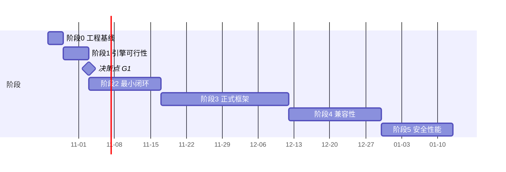

# 分阶段开发任务清单

> 原则：**每阶段都有可编译/可运行/可验证的交付物；上一阶段的门禁未过，不进入下一阶段。**
> 工期按 1 名 Android 工程师计，未含法务与采购等待时间。

---

## 阶段 0：工程与设备基线（2–3 天）

| # | 任务 | 交付物 | 验收 |
|---|---|---|---|
| 0.1 | 建仓、单模块骨架、Compose + Material3 首页 | 可 `assembleDebug` 的 APK | 真机安装启动不崩 |
| 0.2 | 定义 `core:model`（ApkInfo/RuntimeInstance/RuntimeState/EngineCapabilities/EngineResult） | 纯 Kotlin 模块 | 单元测试通过 |
| 0.3 | 设备矩阵登记表（机型/ROM/API/ABI/是否 32 位支持） | `docs/device-matrix.md` | ≥3 台真机 |
| 0.4 | adb/logcat/apksigner 操作手册 | `docs/10-setup.md` | 新人能独立跑通 |

**门禁 G0**：骨架 APK 在至少 1 台真机上正常运行，设备矩阵 ≥3 台。

---

## 阶段 1：引擎可行性（5 天，见 `05-spike-prototype.md`）

| # | 任务 | 交付物 |
|---|---|---|
| 1.1 | 构造 Probe App（两个签名 + 12 项能力探针） | 3 个 APK |
| 1.2 | BlackBox 2.1.0 tag 构建探针宿主，跑通 import/install/launch | 探针 APK + 日志 |
| 1.3 | 完成 V01–V14 用例 | 每机型一份结果表 |
| 1.4 | 真实目标 App 的 R1–R7 | 兼容性报告 |
| 1.5 | 填写 `EngineCapabilities` 实测表（UNKNOWN 也必须写） | `docs/engine-capabilities-actual.md` |
| 1.6 | 决策：路线 A / B / C | 决策记录（含"失败后做什么"） |

**门禁 G1**：V06（同包名不同签名并存）有明确结论。**若 V06 失败且无商业引擎可用 → 项目转为路线 C，需求需与需求方重新对齐。**

---

## 阶段 2：最小可用闭环（2 周）

只做"导入 → 建实例 → 启动 → 停止 → 看日志"一条线，UI 极简。

| # | 任务 | 交付物 | 验收 |
|---|---|---|---|
| 2.1 | `ApkAnalyzer`：包名/版本/签名摘要/minTargetSdk/ABI/权限/组件/SHA-256 | 类 + 单测 | 与 `apksigner verify --print-certs`、`aapt2 dump badging` 结果一致 |
| 2.2 | SAF 导入 + 私有目录复制 + 去重 | `ApkStore` | 同一 APK 重复导入不重复占空间 |
| 2.3 | `VirtualizationEngine` 接口 + `MockEngine` + `EngineGateway` | 接口 + Mock | Mock 下全链路可跑通 |
| 2.4 | 真实引擎适配（BlackBox 或 VA）+ 能力探测 | adapter | 12 项接口验收清单（`04-engine-api.md` §6）全绿 |
| 2.5 | 状态机 + 对账 `reconcileAll()` | 状态机实现 | 强杀进程后状态不撒谎 |
| 2.6 | 文件日志 + 脱敏 + `run_event` 落库 | `RunLogger`/`LogRedactor` | 日志中无 token/密码（用正则自测） |
| 2.7 | 3 屏 UI：首页、导入、详情/运行 | Compose | 真机操作 30 秒内完成一次导入+启动 |

**门禁 G2**：目标 App 能在运行器里登录并保存数据，宿主原 App 不受影响（对应验收标准 1–4）。

---

## 阶段 3：正式应用框架（3–4 周）

| # | 任务 | 说明 |
|---|---|---|
| 3.1 | 多模块拆分（按 `02-architecture.md`） | 拆模块前先冻结接口，避免反复改包名 |
| 3.2 | Room 建库 + 迁移 + 保留策略 | 禁 `fallbackToDestructiveMigration` |
| 3.3 | 6 个页面完整交互 + 空态/错误态/加载态 | Material 3，深色模式，动态取色 |
| 3.4 | 签名冲突二次确认流（`SIGNATURE_MISMATCH`） | 必须"清数据重装"或"新建实例"二选一，不许默认继续 |
| 3.5 | 数据管理：清缓存/清数据/备份/导入备份/删除实例 | 删除必须二次确认 + 说明"只删沙箱内数据" |
| 3.6 | 设置：引擎信息、自检、日志级别、导出诊断包 | 诊断包 = 日志 + 设备信息 + 能力表（脱敏） |
| 3.7 | 权限与风险提示页 | 每个危险权限一行人话解释 + "底层是否真的拦截"标注 |
| 3.8 | WorkManager 长任务 + 前台通知 | 安装/删除不因切后台中断 |

**门禁 G3**：全流程无"假成功"；每个按钮的失败都有可读原因。

---

## 阶段 4：兼容性与稳定性（2–3 周）

| # | 任务 | 说明 |
|---|---|---|
| 4.1 | 机型矩阵回归（≥6 台/4 个 API 版本） | 输出通过率表，不写"整体兼容" |
| 4.2 | 目标 App 深度验证：登录态保持、后台保活、推送、WebView、上传下载、图片渲染 | 逐项 PASS/FAIL |
| 4.3 | 崩溃/ANR 归因链路：`captureLogs` + tombstone 可读部分 | 崩溃能在诊断页看到"哪个库/哪个 so" |
| 4.4 | 异常恢复：安装中断、断电、磁盘满、引擎崩溃 | 12 个故障注入用例 |
| 4.5 | 省电策略与保活引导 | 明确"厂商 ROM 可能杀进程" |

**门禁 G4**：故障注入用例 100% 不产生数据损坏/状态撒谎。

---

## 阶段 5：安全与性能（2 周）

| # | 任务 | 说明 |
|---|---|---|
| 5.1 | 隔离审计：确认无路径穿越、无宿主数据泄漏 | 用"恶意 Probe"尝试读宿主 `files/`、读其它实例数据 |
| 5.2 | 权限诚实性审计 | 逐个开关核对底层是否真的生效；不生效的一律标灰 + 文案说明 |
| 5.3 | 性能基线：冷启动、首帧、RSS、CPU、耗电 | 每项 10 次取中位数，写清机型/版本/引擎版本 |
| 5.4 | 长稳：连续运行 8 小时 / 反复启停 100 次 | 无泄漏、无累积崩溃 |
| 5.5 | 合规审查（见 `08-compliance.md`） | 法务签字 |
| 5.6 | 文案审查 | 全文不得出现"虚拟机/独立内核/绝对安全"等误导表述 |

**门禁 G5**：性能数字全部来自实测表格；宣传物料与实测一致。

---

## 总进度与关键路径

> 若 G1 判定走"商业授权"，需在 阶段2 之前插入采购与合同周期（不可压缩，且可能 2–6 周）。**这条要提前告知需求方，否则整个排期会在这里断掉。**

---

## 任务优先级（如果只能做一半）

必须做：`ApkAnalyzer`（验收标准 1）、签名冲突策略（标准 2）、引擎 install/launch/stop（标准 3）、状态对账（标准 7）、日志与崩溃记录（标准 6）、删除实例只删沙箱（标准 5）、能力诚实标注（标准 8）。

可以砍：多实例、备份、主题定制、多引擎切换、应用图标美化。
